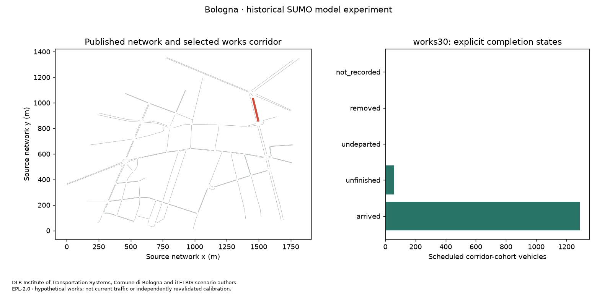
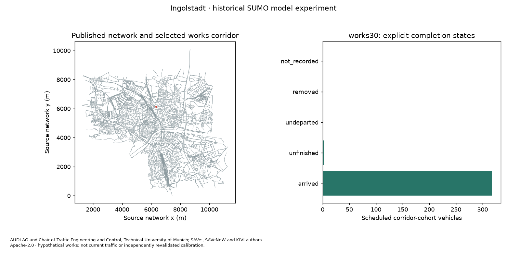

# Historical SUMO works experiment: reviewed findings

These are **computational historical-model experiments** in Bologna Acosta and Ingolstadt. They demonstrate acquisition, original-tool reuse, native/protocol equality and two-host operation. They do not inherit calibration, establish current traffic, identify a causal mechanism or approve an intervention.

## Exact numerical outcomes

| Quantity | Bologna Acosta | Ingolstadt |
| --- | --- | --- |
| Source model | Historical 08:00–09:00 demand, November 2008 observations | 2020-09-16 published modeled demand |
| Source network edges / nodes / traffic lights | 178 / 112 / 7 | 27,754 / 12,138 / 124 |
| Selected edge | `204a[0]`, 190.3 m | `54858973#0`, Theodor-Heuss-Straße, 118.79 m |
| Passenger lanes limited from 13.89 m/s to 30 km/h | `_0`, `_1`, `_2` | `_2`, `_3`, `_4`; non-passenger `_0`/`_1` unaffected |
| Scheduled vehicles in departure slice | 8,772 | 6,492 |
| Corridor scheduled cohort | 1,348 | 320 |
| Cohort arrived / unfinished, baseline | 1,330 / 18 | 318 / 2 |
| Cohort arrived / unfinished, works | 1,289 / 59 | 318 / 2 |
| Matched completed pairs | 1,289 | 318 |
| Excluded censored pairs / teleport-identified completed pairs | 59 / 0 | 2 / 1 |
| Eligible paired denominator | 1,289 | 317 |
| Mean paired scheduled-to-arrival change | +126.994569 s | +15.272082 s |
| Mean paired in-network duration change | +101.621412 s | +15.264196 s |
| Mean paired insertion-delay change | +25.373157 s | +0.007886 s |
| Strictly greater than +30 s / less than −30 s | 991 / 37 | 74 / 24 |
| Native/MCP checks | 80 passed | 73 passed |

The entire cohort is retained in [Bologna's comparison](evidence/bologna/comparison.csv) and [Ingolstadt's comparison](evidence/ingolstadt/comparison.csv), including IDs, both completion states, teleport flags, eligibility and nullable threshold results. All scheduled vehicles, including background traffic, are in each city's baseline/works `all-vehicles.csv`. No censored trip is treated as zero delay or a false threshold flag.

The strict threshold uses the paired native arrival difference; identical scheduled departure cancels. Decimal precision is handled explicitly. The same paired scheduled-to-arrival mean decomposes into in-network duration and insertion delay. Comparing two separately completed-only mean populations would change the denominator and is not this paired result.

A scheduled cohort vehicle's **published planned route** contains the edge. We do not claim it traversed the edge under rerouting, an observed field exposure, or that every changed trip's outcome has an isolated physical mechanism. Source vType distributions and Ingolstadt's 0.2 rerouting probability remain seeded; no new random demand is generated. Single-seed results provide no uncertainty interval or statistical significance.

## Model-quality limits are part of the result

Bologna's all-vehicle baseline states are 8,414 arrived, 126 unfinished and 232 undeparted; works has 8,352 arrived, 131 unfinished and 289 undeparted. None of the cohort is undeparted, removed or unrecorded. All native teleport/collision/emergency counters and incompatible-program warnings are zero in these two runs. This does not validate the authors' warm-up, constrained route-choice area, historical calibration or multilane-roundabout behavior for a current application.

Ingolstadt's baseline has 6,480 arrivals and 12 unfinished vehicles; works has 6,481 and 11. Both insert all 6,492 scheduled vehicles. Each native run reports **577 incompatible signal-program warnings, 20 teleport events and two collisions**. Emergency stops are 222/227 and emergency braking 341/364, baseline/works. Native warning-log teleport starts reconcile with the native event count. The cohort's `pv_7_15063` and `pv_7_15068_1` remain unfinished in both runs; `pv_7_3298_0` completes both but is excluded because its baseline includes an identified teleport. One identified cohort vehicle is not 20 unique corridor vehicles: event and vehicle denominators are distinct.

The original publisher tested SUMO 1.19.0. Our separately retained [native compatibility probe](evidence/compatibility.json) still records 577 incompatible-program warnings, 19 teleports and one collision in Ingolstadt under 1.19. It changed the native binary only, retaining 1.28 bindings, and used the prototype baseline; it is not a complete final-method or matched-binding 1.19 validation. A downgrade is not a demonstrated repair. Do not describe mutual signal conflicts as formatting-only warnings or hide them with `--no-warnings`. No physical safety or current forecast admission is granted.

The source model's full study network is retained but only a bounded departure slice is loaded, with empty initialization and 15-minute evaluation warm-up. Earlier traffic is absent. Both cities' warm-up/cool-down and stable departure/ID merge are explicit experimental transformations, not newly validated choices. Mandatory signals/additional-file order and every selected vehicle's original attributes/subtrees are preserved. Optional GUI files are excluded explicitly.

## Docker, protocol and agent evidence

The [source-bound native dossiers](evidence/reproduction.json) verify all 13 exposed tools, three resource URI families and the prompt, original vehicle subtrees, original direct TraCI equality, every trip XML/CSV state, strict threshold flags and native/MCP summary/CSV/map equality. Ten synthetic tests cover threshold equality, censoring, insertion delay, teleport exclusion, process ownership, original retry stdout, source identity and unsafe/corrupt archives. Seven original-method probes have explicit synthetic-stub scope. Metadata CI is separate from all of these.

| Host / city | Actual calls / rejected or host-blocked calls | Full pages, native-equivalent numeric artifacts and JSON | Broader prose |
| --- | --- | --- | --- |
| Codex / Bologna | 48 / 4 | Passed, all 13 tool families | Factual pass; 519 words, within 600 |
| Hermes / Bologna | 46 / 6 | Passed after recovery, all 13 | Facts and length fail; 776 words |
| Codex / Ingolstadt | 44 / 7 | Passed after source-name recovery, all 13 | Factual pass; 517 words |
| Hermes / Ingolstadt | 62 / 28 | Passed after recovery, all 13 | Facts and length fail; 1,112 words |

All four observed comparison CSVs were returned completely (eight pages in Bologna, two in Ingolstadt), and actual result/source pages match backend artifacts. The [host receipts](evidence/agents.json) bind launch commit `a3f857ca1ae2d3689749fc71ad7b8d8a0990adaf`, public task, process, trace and answer bytes. Complete allowed public payloads are committed; private host configuration, databases, reasoning and authentication are excluded. Codex CLI 0.167.0-alpha.3.2 and Hermes 0.18.2 were used with existing host authentication; Hermes used its isolated Claude Sonnet 4.6 provider profile.

Hermes Bologna first sent a `variables` array instead of one `variable`. Its brief then omits a recovered error and labels unknown timing proprietary without supporting source evidence. Hermes Ingolstadt also tried baseline comparison paths and wrong absolute-step actions/keys, triggered its failure circuit, retried while blocked and ultimately recovered. Its brief reports the circuit but supplies unsupported mechanism/formatting explanations and ambiguous exclusion arithmetic. The implementing reviewer records [explicit answer-hash-bound corrections](evidence/narrative-review.json); observed failed briefs remain unchanged. Successful numeric JSON does not admit inaccurate municipal advice.

Original FCD inspection yields 101 sample points at mean 12.81 m/s in Bologna and 117 at 13.73 m/s in Ingolstadt (reported to two decimals). These are sample-weighted instantaneous speeds at 10-second output spacing, not unique vehicle counts, journey means or field observations. Live counters after the 30-second absolute TraCI advance cover that advance, which spans multiple native numerical steps. They are not whole-run cumulative totals or a single instantaneous 0.25/1 s count.

The two native PNGs below were visually inspected by the implementing reviewer. Host render receipts and byte equality establish artifact production, not agent image viewing. This review is not the independent-person gate.

## What the next municipality must contribute

A repeatable local experiment needs permitted dated network/coordinates, lane restrictions, demand and vehicle definitions, compatible signals/stops, explicit scenario geometry, meaningful initialization and independent observations for calibration/validation. These two published model bundles solve the input-binding demonstration; they do not supply fresh demand for every city. Repairing a source signal model needs qualified review and new validation, not a hidden adapter adjustment.

An independent **person** must operate a distinct third city through harvest/native/MCP and both hosts, submit public evidence and obtain accepted review before [final-product promotion](../../docs/product-qualification.md). All four current observations were operated by the original implementation team. Issue #41 remains the separate walking reproduction task. Code/data notices remain in [LICENSE.md](LICENSE.md) and source snapshots.
