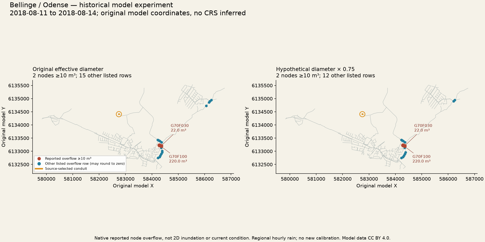
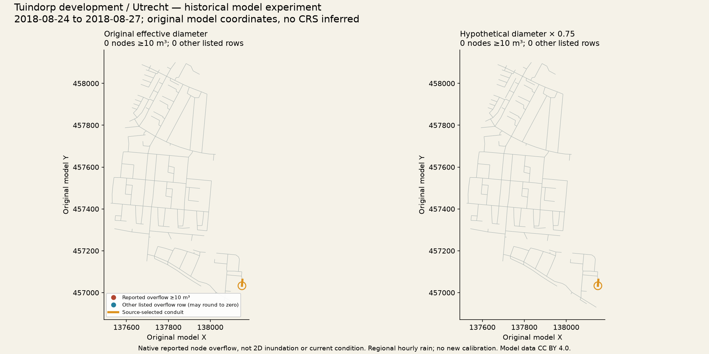

# Municipal findings and limits

The useful municipal question is whether a reproducible, declared loss of
effective diameter changes the modeled nodes reaching a reported overflow
threshold. Both neighborhoods have real published hydraulic models and real
regional observations, with rights and source bytes available to contributors.
Open streets or a generic municipal portal cannot replace pipe inverts,
sections, catchments, controls or boundary/DWF assumptions.

## What actually happened

| Quantity | Bellinge / Odense | Tuindorp development / Utrecht |
| --- | --- | --- |
| Original model nodes / conduits | 1,020 / 1,015 | 311 / 345 |
| Selected wet day | 2018-08-12 | 2018-08-25 |
| Wet-day / whole 72-hour forcing | 19.7 / 31.0 mm | 20.575 / 23.025 mm |
| Regional station | DMI 06120 | KNMI 260 De Bilt |
| Source-selected conduit | `G75F65Y_G75S541_l1` | `c_906791` |
| Original → scenario diameter | 0.104 → 0.078 m | 0.300 → 0.225 m |
| Listed overflowing nodes, baseline → scenario | 17 → 14 | 0 → 0 |
| Nodes at or above 10 m³, baseline → scenario | 2 → 2 | 0 → 0 |
| Newly reaching that reported threshold | 0 | 0 |
| Sum of displayed node overflow volumes | 245 → 245 m³ | 0 → 0 m³ |
| System flooding loss | 245 → 245 m³ | 0 → 0 m³ |
| Routing continuity error | 0.322% → 0.323% | −0.134% → −0.134% |
| Runoff continuity error | −0.003% in both | −0.098% in both |
| Native geometry warnings per run | 15: ten WARNING 04, one WARNING 10, four WARNING 02 | 16 WARNING 04 |

In Odense, **`G70F030` reports 22 m³ and `G70F100` 220 m³** in both scenarios.
The remaining displayed contributions bring the node sum to 245 m³. A listed
overflow row can round to zero: native report resolution is **1 m³**, not proof
of exactly zero physical overflow. The threshold applies to those **reported**
volumes. The full [comparison CSV](evidence/odense/comparison.csv) retains every
one of the 1,020 source nodes, their two states/volumes and transition flags.

Utrecht's [complete comparison](evidence/utrecht/comparison.csv) retains all
311 nodes. No overflow occurs in this bounded model/forcing experiment. We
did not enlarge rain, change the selected pipe or replace sources to force
a dramatic result. A null result does not establish that a present-day sewer
is safe, a pipe needs no maintenance, or a larger/local/subhourly event would
produce the same outcome. Diameter sensitivity is nonlinear; the change in
listed small overflow rows is not a general monotonic-risk conclusion.

The current equality of system loss and summed displayed node volumes is an
observed numerical result. They remain distinct quantities: Bellinge permits
ponding, Tuindorp does not, and rounding/re-entry can make those totals differ.
Low continuity error is a numerical diagnostic, not accepted field calibration.

## Model geometry, not flood polygons

The figures use original model coordinates and native report rows, with the
selected conduit highlighted. No geographic CRS, inundation extent, property
damage or population exposure is inferred. Each [map receipt](evidence/odense/map-receipt.json)
binds the original input and CSV/quality hashes; [Utrecht receipt](evidence/utrecht/map-receipt.json).
Model data remain CC BY 4.0 with publisher attribution.

## What the tests demonstrate

Both city suites pass **176 / 160** checks across the original EPA CLI oracle,
complete report-derived node/outfall CSVs and actual SDK/stdio MCP calls. All
**27 tools**, eight resource families and the prompt are exercised, including
original live controls, hotstart save/load, cancellation and deliberate errors.
The unchanged original MCP suite passes **22** tests, with **12** separate
synthetic regressions and **seven** isolated original-method audit probes.

All four final Codex/Hermes runs reproduce full numerical artifacts, complete
required pages and checked JSON. Each also passes **33** comparisons of actual
returned series/snapshot values against the independent native binary output.
The final task checks session status before close and uses the same source/task
revision in all four empty host/city workspaces. These are independent host
processes under the **same original human operator**, not the independent-person
qualification gate.

| Final host observation | Calls | 27 tools / pages / native queries / JSON | Prose |
| --- | --- | --- | --- |
| Codex, Odense | 66 | Passed after two expected invalid requests | Passed; 157 words |
| Codex, Utrecht | 62 | Passed after two expected invalid requests | Passed; 156 words |
| Hermes, Odense | 72 | Passed after retained recoverable errors | Failed facts and length; 223 words |
| Hermes, Utrecht | 62 | Passed after retained recoverable errors | Failed facts and length; 228 words |

Hermes Odense misclassifies all 15 warning lines as WARNING 04 and adds
unsupported continuity-warning wording; its license abbreviation is wrong.
Hermes Utrecht calls diagnostics acceptable without a defined acceptance
criterion and truncates the dataset DOI. Both exceed the 180-word limit.
Their original answers and negative [answer-bound prose verdicts](evidence/narrative-review.json)
remain public. Correct structured JSON does not admit those briefs as advice.

Both full Hermes tasks also omit the requested live subcatchment `runoff`
field. The 27-family and numeric verdicts do not make those tasks complete.
Two separate [narrow live-observation runs](evidence/live-observations.json)
subsequently read `rainfall` and `runoff` at initialization and after 30 seconds,
passing eight comparisons per city against direct original PySWMM. These
observed values are zero during that initial dry interval, not whole-event
runoff totals. The Odense supplement omits its own open-session resource read;
that operation was covered in the full run. Neither supplement replaces the
original omissions or failed prose verdicts.

The [agent index](evidence/agents.json), [native reproduction](evidence/reproduction.json),
[live MCP acquisition](evidence/live-mcp.json), [source audit](evidence/upstream-audit.json)
and [development failures](evidence/development-failures.json) expose the boundaries
instead of replacing failed observations with corrected answers.

## Decisive input limits

The published models are historical neighborhood networks, not current complete
municipal inventories. Original Bellinge models were explicitly uncalibrated;
Tuindorp was adapted from InfoWorks and originally run with SWMM 5.1.015. A new
5.2.4 run does not inherit calibration. Source coordinate systems and physical
parameters remain as published; a global EPSG code is not guessed.

Rain is hourly and regional, uniform across the original gauges. Local
convective variation and subhourly peaks are unresolved. DMI QA validity is
retained but is not hydraulic field validation. The downloaded DMI window
admits 30 complete three-day candidate windows in August; KNMI admits 31.
Only eligible complete windows enter the deterministic selection. KNMI's nine
trace intervals add ±0.225 mm midpoint uncertainty to the whole forcing window.
The empty-start 24-hour warm-up is a convention, not demonstrated equilibrium.

The declared Tuindorp normalization changes 13 NaN impervious percentages only
where source catchment area is exactly zero. It supplies no missing positive-area
physical parameter. Every original row and unmodified source file is retained.
No learned GNN weights, synthetic rain, invented pipes or noncommercial Bellinge
rain collection are used. Contributions need their own permitted hydraulic
model and rainfall, not merely another city name.

`calibration_revalidated`, `forecast_admitted` and `product_qualified` all remain
false. [Issue #46](https://github.com/polisplexity/urban-mcp/issues/46) requires an
independent person harvesting and reproducing a third city with public review
before final-product promotion. Integration of this development experiment
does not satisfy that rule.
