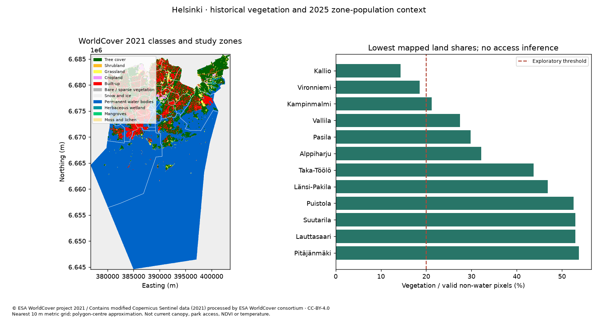
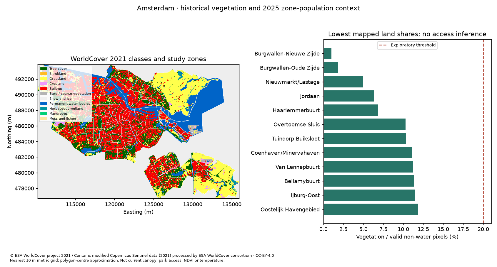

# Municipal findings: historical vegetation screening

Question: which represented statistical zones have vegetation share strictly below an exploratory cutoff, and how much published aggregate population is attached? Land cover is **WorldCover 2021 v200**, harvested on 2026-11-10. Population is 2025 with city-specific dates. This is neither current greenery nor access, canopy percentage, temperature, individual exposure or a causal study.

| Observed quantity | Helsinki | Amsterdam |
| --- | --- | --- |
| Represented zones / zones with valid land | 34 / 34 | 111 / 111 |
| Population date | 2025-12-31 | 2025-01-01 |
| Low zones at 0.20 / known attached population | 2 / 51,906 | 26 / 217,945 |
| Low zones at 0.40 / known attached population | 6 / 144,068 | 65 / 557,965 |
| Pooled vegetation / valid land | 65.476258% | 55.081371% |
| Pooled vegetation / all valid surface | 19.662639% | 44.501542% |
| Water pixels / NoData in assigned zones | 5,003,110 / 0 | 468,010 / 0 |
| Municipal total minus known zone population | 13,682 | 11 |

Vegetation includes tree cover, shrubland, grassland, cropland, herbaceous wetlands, mangroves and moss/lichen. Water and NoData are excluded from the land denominator and reported separately. The 10 m local metric grid uses nearest resampling; it does not add source detail to native geographic pixels. Polygon-centre membership approximates boundary area; shares are pooled pixel fractions, not an average of zone percentages. NoData coverage is not classifier confidence. The separate InputQuality product is not acquired by this Map recipe.

## Helsinki

Baseline has 2 zones below 0.20. Full zone/class records are in [helsinki baseline CSV](evidence/helsinki/baseline.csv) and [native JSON](evidence/helsinki/native.json).

| Source zone ID | Source name | Vegetation / valid land | Published population |
| --- | --- | --- | --- |
| `101` | Vironniemi | 18.5753% | 13,280 |
| `301` | Kallio | 14.3548% | 38,626 |

Newly below 0.40: `103`, `302`, `303`, `304`. No zones leave the low set. This changes the cutoff on identical observations; it is not vegetation loss. [Complete sensitivity CSV](evidence/helsinki/sensitivity.csv).

All 34 zones have population and valid land. Zone sum 680,710 differs from municipal 694,392 by 13,682; no demographic explanation is inferred. Land cover is 2021, population reference date is 2025-12-31 and boundary acquisition is 2026-11-10. No random-rounding rule is declared for these Helsinki data.

## Amsterdam

Baseline has 26 zones below 0.20. Full zone/class records are in [amsterdam baseline CSV](evidence/amsterdam/baseline.csv) and [native JSON](evidence/amsterdam/native.json).

| Source zone ID | Source name | Vegetation / valid land | Published population |
| --- | --- | --- | --- |
| `WK0363AA` | Haarlemmerbuurt | 6.8660% | 9,145 |
| `WK0363AB` | Jordaan | 6.3439% | 19,485 |
| `WK0363AC` | Grachtengordel-West | 15.3586% | 6,505 |
| `WK0363AD` | Burgwallen-Nieuwe Zijde | 0.9870% | 4,345 |
| `WK0363AE` | Burgwallen-Oude Zijde | 1.8630% | 4,760 |
| `WK0363AF` | Nieuwmarkt/Lastage | 4.9341% | 9,940 |
| `WK0363AG` | Grachtengordel-Zuid | 17.7085% | 5,710 |
| `WK0363AH` | De Weteringschans | 16.4623% | 7,570 |
| `WK0363BB` | Coenhaven/Minervahaven | 11.1231% | 1,765 |
| `WK0363EC` | Houthavens | 16.4165% | 5,475 |
| `WK0363EH` | Staatsliedenbuurt | 16.3446% | 12,945 |
| `WK0363EM` | Hoofdweg e.o. | 16.0509% | 10,045 |
| `WK0363EP` | Bellamybuurt | 11.2959% | 6,250 |
| `WK0363EQ` | Da Costabuurt | 18.7170% | 4,710 |
| `WK0363ES` | Van Lennepbuurt | 11.2355% | 6,910 |
| `WK0363ET` | Overtoomse Sluis | 10.2832% | 7,675 |
| `WK0363EU` | Helmersbuurt | 17.1943% | 7,400 |
| `WK0363KF` | Nieuwe Pijp | 13.4042% | 12,550 |
| `WK0363MA` | Oostelijk Havengebied | 11.8328% | 20,760 |
| `WK0363ME` | Dapperbuurt | 17.5494% | 10,000 |
| `WK0363MF` | Indische Buurt-West | 13.9983% | 12,045 |
| `WK0363MJ` | IJburg-West | 15.9986% | 16,090 |
| `WK0363MK` | IJburg-Oost | 11.4990% | 1,535 |
| `WK0363NB` | Noordelijke IJ-oevers-West | 13.3021% | 12,010 |
| `WK0363NM` | Tuindorp Buiksloot | 10.3129% | 1,910 |
| `WK0363NP` | Noordelijke IJ-oevers-Oost | 19.8693% | 410 |

Newly below 0.40: `WK036399`, `WK0363AJ`, `WK0363AK`, `WK0363BA`, `WK0363ED`, `WK0363EE`, `WK0363EG`, `WK0363EJ`, `WK0363EK`, `WK0363EL`, `WK0363EN`, `WK0363ER`, `WK0363EV`, `WK0363FC`, `WK0363FG`, `WK0363FH`, `WK0363FK`, `WK0363FN`, `WK0363KA`, `WK0363KB`, `WK0363KD`, `WK0363KE`, `WK0363KG`, `WK0363KH`, `WK0363KJ`, `WK0363KK`, `WK0363KL`, `WK0363KP`, `WK0363MB`, `WK0363MC`, `WK0363MD`, `WK0363ML`, `WK0363NC`, `WK0363NK`, `WK0363NN`, `WK0363SC`, `WK0363SD`, `WK0363TE`, `WK0363TH`. No zones leave the low set. This changes the cutoff on identical observations; it is not vegetation loss. [Complete sensitivity CSV](evidence/amsterdam/sensitivity.csv).

All 111 zones have some valid mapped land, including `WK036399` Groot water (16,297 land pixels, share 26.0600%). Its source water-zone flag does not exclude it. It is not low at 0.20 and becomes low at 0.40. Its population sentinel is preserved as null: **unknown, never zero or no residents**. The 0.40 attached count is a known-population subtotal with that zone still unknown. Known zone population 934,515 differs from municipal 934,526 by 11; CBS district counts are randomly rounded to multiples of five. Population reference date is 2025-01-01.

## Bounded municipal use

Use the low-zone list to choose a **current-imagery and local validation exercise**, with explicit study boundaries and exploratory cutoff. Verify classification and current conditions, boundary definitions, land ownership, utilities, soil and maintenance before site planning. Tree-class area is categorical area, not fractional canopy. Aggregate population does not locate residents in pixels. Different population dates, boundaries and sea coverage prevent interpreting the table as a validated city ranking.

The [source-rights record](LICENSE.md), [exact recipe](recipe.json) and [hash-bound evidence](evidence/README.md) accompany the outputs. WorldCover global accuracy is not local validation. Final-product promotion still needs an independent person reproducing a third city.
