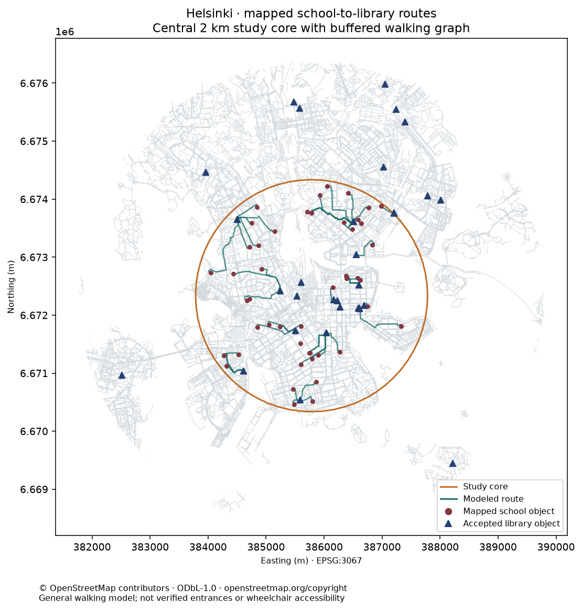
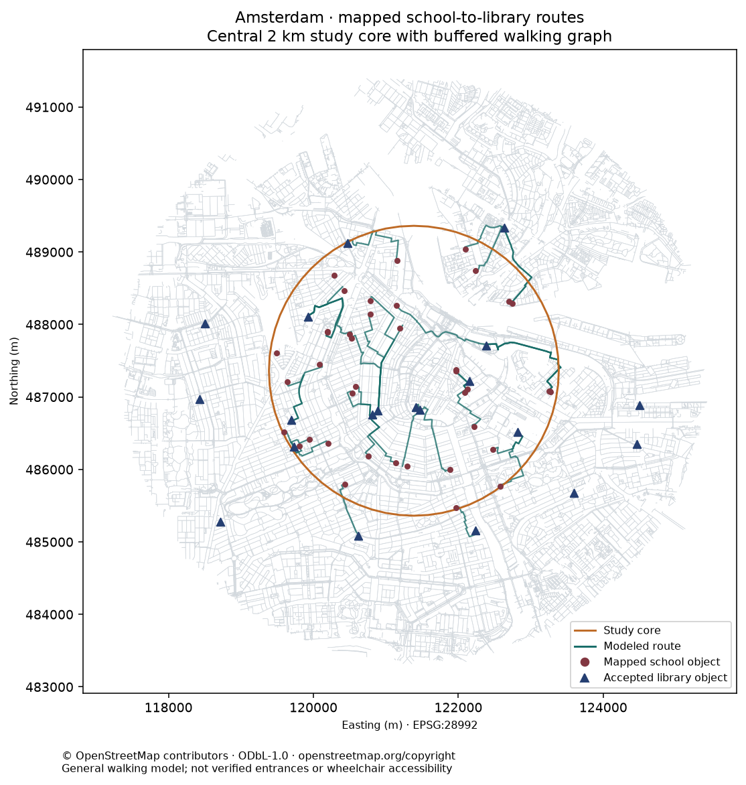

# Municipal findings and decision limits

These are results from two **central 2 km study disks**, not full municipal assessments. Inputs were acquired on 2026-11-10 UTC and published as [hash-locked ODbL snapshots](https://github.com/polisplexity/urban-mcp/releases/tag/data-walking-20261110). The same distance/snap/closure recipe runs in both cities. Differences in source completeness and facility types prevent using these percentages as a city ranking.

## Baseline: mapped school-to-library objects

The declared threshold is 1,200 m, including both straight snap connectors and the shortest graph path. Assumed minutes use 4.8 km/h; no measured journey times or demand data were acquired.

| Result | Helsinki | Amsterdam |
| --- | ---: | ---: |
| Mapped school objects in the core (denominator) | 48 | 40 |
| Routed | 46 | 38 |
| Within 1,200 m | 45 | 22 |
| Routed beyond 1,200 m | 1 | 16 |
| Unreachable on the snapshot | 2 | 2 |
| Rejected school snaps | 0 | 0 |
| Accepted library objects in the buffer | 31 | 20 |
| Accepted libraries with unknown access tags | 30 | 20 |
| Libraries rejected for `access=no/private` | 0 | 1 |
| All-feature representative points outside the buffer | 1 | 3 |
| Graph nodes / directed edges | 111,650 / 247,056 | 79,384 / 176,632 |
| Weak components retained | 1,264 | 468 |

The two unreachable objects in each city have accepted snaps but no graph path to an accepted library. These data alone do not establish whether the cause is a missing mapped connection, a real access restriction, an incorrect facility point or another issue. The outside-buffer flag concerns the full harvested feature collection; it is not a count of core school origins, rejected school snaps or routed schools. A polygon representative point is not a centroid or a verified entrance.

The library destination pool includes specialist and academic libraries. Missing access tags remain unknown. Even `access=yes` is an OSM assertion, not independently confirmed public admission for a school group. Campus/building nodes and polygons can also represent one institution more than once. This is why the results count **mapped objects**, rather than distinct schools or people with adequate public-library service.

## Hypothetical link closure

For each city, remove the most-used node-pair link among the baseline routes, breaking ties by node IDs. Remove both directions and all parallel edges. This is a reproducible stress-test choice, not an observed closure, an optimal criticality ranking or a proposed intervention.

| Result | Helsinki | Amsterdam |
| --- | --- | --- |
| Removed node pair | `501610897 ↔ 5912225309` | `46386552 ↔ 12534903767` |
| School objects with a longer route | 11 | 5 |
| Additional distance among affected objects | 87.0–649.0 m | 91.4–328.1 m |
| Within-threshold count, before → after | 45 → 40 | 22 → 22 |
| Newly unreachable | 0 | 0 |

Amsterdam demonstrates why a zero threshold change does not mean a disruption has no modeled effect: five objects have detours even though their routes remain under the scenario limit. Helsinki demonstrates a threshold-sensitive scenario: five objects move beyond 1,200 m. Neither establishes how many pupils would be affected or whether the removed link represents a suitable real works scenario.

Exact rows: [Helsinki baseline](evidence/helsinki/baseline.csv), [closure](evidence/helsinki/closure.csv), [comparison](evidence/helsinki/native-comparison.json); [Amsterdam baseline](evidence/amsterdam/baseline.csv), [closure](evidence/amsterdam/closure.csv), [comparison](evidence/amsterdam/native-comparison.json).

## Evidence quality

Each city passes 62 native/protocol checks across all 15 exposed MCP tools, all resource families and the municipal prompt. Every school row agrees with a separate forward shortest-path calculation enumerating all accepted libraries, rather than only comparing a wrapper with itself. Native and MCP CSV bytes match. GraphML round trips preserve nodes, keyed edges and lengths; edge removal cannot shorten shortest paths. Six separate synthetic tests cover corrupted inputs/archives, path traversal, wrong city/recipe and lock mismatches. They are integrity regressions, not municipal observations.

Both maps were visually checked for study boundary, routes, facilities, metric CRS labels and attribution. The snapshots restore into a fresh Docker workspace; deterministic reproduction needs no LLM account. Agent-host artifacts and final interpretations are reviewed separately in the [evidence guide](evidence/README.md) and [master record](../../MASTER_TEST_RECORD.md).

## A useful next municipal investigation

First reconcile OSM facility objects with authoritative active-school and public-library registers, including admission/hours and campus identity. Verify pedestrian entrance coordinates and the four modeled-unreachable origins with local staff. Check the physical meaning, crossings, barriers, foot-direction rules and seasonal conditions of the stress-test links. Then rerun the same recipe with those admitted improvements. Add enrollment or population only through a separate data contract and denominator.

The reproducible software/data workflow is testable now. Public-service adequacy, observed travel time, safe/wheelchair access and investment priorities remain unproven by this experiment.

## Maps

© [OpenStreetMap contributors](https://www.openstreetmap.org/copyright). Databases and OSM-derived data: [ODbL-1.0](https://opendatacommons.org/licenses/odbl/1-0/). These maps include the same attribution; their presentation does not grant new rights over original source data.
