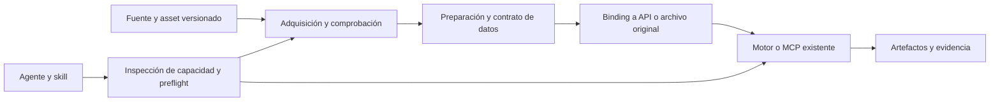

# RFC 0001 — Capacidades urbanas con datos y operación reproducible

Estado: **propuesta abierta**. Fecha: 2026-11-10. No hay elección global de lenguaje, framework MCP o agente.

## Problema

Exponer una función por MCP no vuelve utilizable una herramienta urbana. Un agente puede conocer `run_model` y carecer de red, demanda, meteorología, licencia, configuración o forma de interpretar los resultados. El producto debe mantener la cadena completa desde la fuente hasta una operación comprobada.

## Unidad de contribución

Un **paquete de capacidad** vincula:

1. Software original y operación concreta, con versión/API.
2. Contrato de entradas por operación y requisitos científicos.
3. Fuentes y assets admitidos, incluidas condiciones de acceso.
4. Preparación reproducible y binding al motor.
5. Instalación/ejecución aisladas, utilizando mecanismos originales.
6. Caso nativo de referencia, prueba MCP y evidencia de operación por un agente.
7. Instrucciones breves, límites y recuperación de errores.

No todos los repositorios necesitan un paquete ejecutable. Bibliotecas, estándares y catálogos siguen siendo dependencias o referencias; alternativas equivalentes se comparan antes de admitirlas.

## Cinco interfaces distintas

- **Fuente → asset:** resolver archivo/query/snapshot, identidad, acceso, derechos y fingerprint. No confundir el portal con el dataset.
- **Asset → datos preparados:** recortar, reproyectar, alinear tiempo/unidades, unir IDs o validar topología. Registrar herramientas, parámetros y pérdidas.
- **Datos → motor:** mapear cada entrada al archivo, sección y parámetro nativos. Los campos de nuestro catálogo no se envían automáticamente como argumentos MCP.
- **Motor → resultado:** conservar diagnóstico, unidades, cobertura, escenario/revisión y enlaces a artefactos. Una corrida terminada no implica validez científica.
- **Agente → flujo:** inspeccionar qué está disponible, resolver faltantes, ejecutar únicamente casos admitidos y explicar alcance con evidencia.

## Dos rutas de datos

**Día cero de referencia:** un caso pequeño seleccionado y admitido, con datos descargables o incluidos legalmente, preparación reproducible y resultado comprobado. Puede ser sintético, indicado en todo el flujo. Funciona como onboarding y CI, no como diagnóstico de una ciudad.

**Proyecto de ciudad real:** entradas locales, cobertura y finalidad definidas. Las fuentes abiertas pueden completar partes. Datos del operador y modelos calibrados siguen siendo necesarios cuando corresponda. El sistema debe informar que una capacidad necesita entradas, credenciales o revisión, aunque otra operación de la misma herramienta esté disponible.

Ejemplos: calles OSM no son demanda SUMO; Copernicus DEM es un producto de superficie, no cotas de alcantarillado; una huella y EPW no definen HVAC/materiales/ocupación; GTFS no es una encuesta de viajes. La sustitución por datos globales o supuestos debe ser explícita y no puede crear silenciosamente un estado «calibrado».

## Contratos y estados

`registry/tools.json` relaciona 229 candidatos con perfiles iniciales de datos y decisiones de investigación. `registry/sources.json` registra canales; `registry/data-profiles.json` propone requisitos para un primer caso representativo. **Todavía no son bindings por operación ni fuentes admitidas.**

La siguiente contribución desagrega cada operación en un manifiesto de capacidad. Estados separados:

| Estado | Evidencia necesaria |
|---|---|
| catalogued | Identidad y propósito de la herramienta. |
| source-admitted | Asset exacto, acceso y derechos revisados; no solo página del proveedor. |
| data-prepared | Checksums/snapshot, preparación y validación de entradas. |
| native-verified | Caso ejecutado directamente con versión y resultado conocido. |
| mcp-verified | Mismo caso por un cliente MCP; resultado y errores comprobados. |
| agent-verified | Otro agente puede completar el flujo y reconocer faltantes/límites. |

La disponibilidad se calcula por capacidad, caso y entorno. No es una etiqueta única para toda una herramienta. Un flujo puede estar disponible con fixture y bloqueado para ciudad real.

Operaciones transversales **propuestas, no implementadas**: inspeccionar requisitos/capacidades; planificar adquisición; preparar/validar entradas; ejecutar/consultar/cancelar caso; recuperar artefactos. Los nombres y schemas se decidirán en el primer vertical. Se reutiliza el sistema de jobs del original cuando exista.

## Sandbox propuesto

- Separar adquisición con red de ejecución con datos admitidos y acceso de red solo cuando sea necesario.
- Entradas de solo lectura, salida por caso, usuario sin privilegios, límites de CPU/memoria/tiempo y limpieza de procesos comprobada.
- Imágenes/datos/versiones fijados; credenciales inyectadas por el operador y fuera de artefactos y Git.
- Perfiles distintos para CLI, escritorio, JVM, R, GPU y HPC. Docker es el primer entorno reproducible, no una promesa de que cualquier herramienta cabe o funciona dentro de un contenedor.
- Primer caso propuesto: SUMO Hello upstream. Ya están identificados seis assets y sus hashes; falta admitir derechos, fijar runtime Docker, registrar baseline nativo y mapear una operación de un MCP existente.
- El perfil Docker incluido en esta RFC **solo valida planificación/metadatos y datos de referencia**. No ejecuta SUMO ni prueba un agente científico.

## MCP, skills y perfil del agente

MCP define capacidades de ejecución y acceso. Una skill enseña el procedimiento y sus límites. Una capa de datos entrega entradas trazables. Ninguna pieza sustituye a las otras.

Se propone el formato abierto `SKILL.md` como paquete portátil de instrucciones. Clientes sin ese soporte necesitan instrucciones equivalentes mediante sus mecanismos disponibles, como recursos/prompts MCP donde el servidor/host los admita. La compatibilidad debe probarse por cliente, no asumirse por tener un archivo.

`AGENTS.md` orienta a contribuidores de este repositorio. Un `SOUL.md` puede ser opcional en runtimes que lo usen para identidad/estilo; no será dependencia de los motores, fuente de permisos ni sustituto de un contrato técnico. No se integra un framework de agentes ni un proveedor LLM obligatorio en esta fase.

## Qué se conserva y qué no se impone

Se conservan software, MCP, APIs, bindings, datasets y validadores originales. Python, Go, R, JVM y TypeScript se eligen por la frontera de cada capacidad. Las propuestas tecnológicas de investigación no son decisiones aceptadas. Las utilidades Python de este PR validan metadatos y no seleccionan el lenguaje del producto.

No se construye un nuevo solver, un modelo universal de ciudad, un agente obligatorio, un gateway global ni un generador que rellene parámetros físicos desconocidos. Los modelos científicos nuevos o calibraciones pertenecen a tareas separadas con datos y evaluación propios.

## Criterio de aceptación del primer vertical

Desde un checkout limpio y las dependencias declaradas, una persona/cliente debe poder: identificar la capacidad; obtener y verificar el caso permitido; preparar entradas; arrancar el original en Docker; ejecutar baseline; hacer lo mismo por MCP; recuperar artefactos con procedencia; detectar un dato faltante o inválido; cerrar/repetir sin estado oculto. Después se repite con un agente y una skill. Registrar plataformas, límites y lo que la evidencia no demuestra.

## Preguntas para revisión

1. ¿Qué campos mínimos necesita un manifiesto por operación y cómo expresa entradas condicionales o embebidas?
2. ¿SUMO Hello ofrece el primer caso más claro o conviene sustituirlo por otra fixture con mejor cobertura/licencia?
3. ¿Qué MCP SUMO existente cubre el caso sin reescribir control y qué versión requiere?
4. ¿Qué asset/fuente admite cada capacidad, y qué entradas locales siguen bloqueando un caso real?
5. ¿Qué contratos y wrappers existentes resuelven preparación/jobs antes de añadir infraestructura propia?
6. ¿Qué clientes y perfiles deben probarse antes de declarar «agent-verified»?

El roadmap y las tareas derivadas separan investigación, datos, runtime, MCP y agente. La RFC no se vuelve aceptada por aprobar los checks de JSON.
